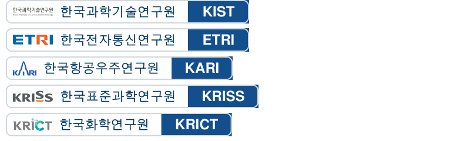

# 연구기관 CI 첫 구현 묶음

공식 ZIP 5건은 기존 기록 SHA-256과 일치하며 ZIP CRC 검사 정상. ZIP 해시와 선택 AI 멤버 해시는 [extraction.json](extraction.json) 및 [출처표](../logo-sources.json)에 별도로 기록했다. 원본은 추적표의 기관 공식 다운로드에서 받을 수 있다.

## 도형·색·완전성 대조

왼쪽은 공식 AI 렌더, 오른쪽은 SVG 렌더다. KARI의 회색 설계 격자는 심벌 구성요소가 아니므로 제외했다. ETRI·KRISS·KRICT는 완전한 공식 워드마크, KARI는 완전한 공식 심벌이다. KIST 다운로드는 한영 로고타입만 제공하므로 이를 전체 추출했으며 별도 심벌을 임의 제작하지 않았다. 이 검증은 다운로드된 공식 제공 아트워크 범위이며 다른 변형 전부에 대한 검증이나 법적 이용 허락이 아니다.

## 실제 배지

원본 경로·곡선 좌표는 유지했다. 인쇄 원본 렌더와 웹 보정 SVG는 **도형 대조**이며 픽셀·색 동일성을 주장하지 않는다. ETRI/KRICT는 공식 이미지의 명시 RGB 숫자, KARI는 공식 웹 HEX로 채움색을 보정했다. KIST/KRISS는 원본 렌더러 색을 유지하며 공식 웹 RGB 인증이 아니다.

## 웹 색상 게이트 재검토 (2026-11-19)

[색상별 치환·팔레트·SVG/근거 해시](web-colours.json). 웹 근거 원문과 이미지는 web-colour-evidence/에 저장했다.

- ETRI: https://www.etri.re.kr/korcon/sub7/sub7_11.etri 및 https://www.etri.re.kr/images/kor/sub5/ci_color02.jpg 의 G102 B165(생략 R=0), R241 G90 B34에 따라 #0066a5 / #f15a22. Blue #0066a6을 정정했다.
- KRICT: https://www.krict.re.kr/kor/sub01_05_01.do 및 https://www.krict.re.kr/images/kor/sub01/sub010501_img04.jpg 의 화면용 RGB 숫자를 읽었다. 채널 미기재는 0이며 HTML O/0 문자열을 임의 보정한 것이 아니다. 9색 순서: (116,198,190), (76,187,180), (0,172,151), (46,182,170), (66,189,216), (0,173,169), (0,153,217), (125,125,125), (0,117,194). 4색 수정, 나머지 5색 일치.
- KARI: https://www.kari.re.kr/kor/contents/92 의 Royal Blue HEX #2a5caa 선택. 같은 페이지 RGB(60,45,160)=#3c2da0과 **내부 불일치**다. 웹 매체를 위한 명시 HEX를 RGB 또는 CMYK 렌더 변환값보다 우선했다. 모순 자체를 해결했다고 주장하지 않으며 Hermes 검토 대기다.
- KRISS: https://www.kriss.re.kr/menu.es?mid=a10101070000 의 전용색상은 Gray PANTONE 425C / Orange PANTONE151C만 명시. 숫자 RGB/HEX 명시를 확인하지 못했다. CSS/렌더러 값은 공식 RGB 인증으로 사용하지 않았다.
- KIST: https://kist.re.kr/ko/intro/kist-ci.do 및 www 호스트 재시도 모두 HTTP400. 공식 웹 RGB 명시 여부 이번 회차 확인 불가. 원본 렌더 색 유지, 미확인을 '명시 없음'으로 단정하지 않는다.

기존 공식 PNG는 인쇄 원본 렌더 보존, SVG PNG와 비교 이미지는 현재 색으로 갱신했다. 해시 동일성은 출처 바이트 동일성일 뿐 색 인증이 아니다. 전체 45곳 미완료, 5곳도 색상 재검토 대기로 complete=false. 모든 PR 병합 보류, 추가 구현 보류. 법적 이용 허락 미확인은 유지한다.
