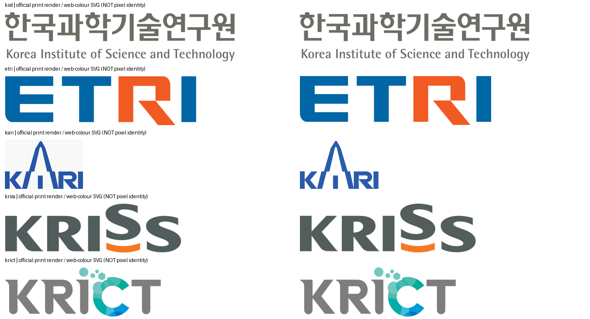
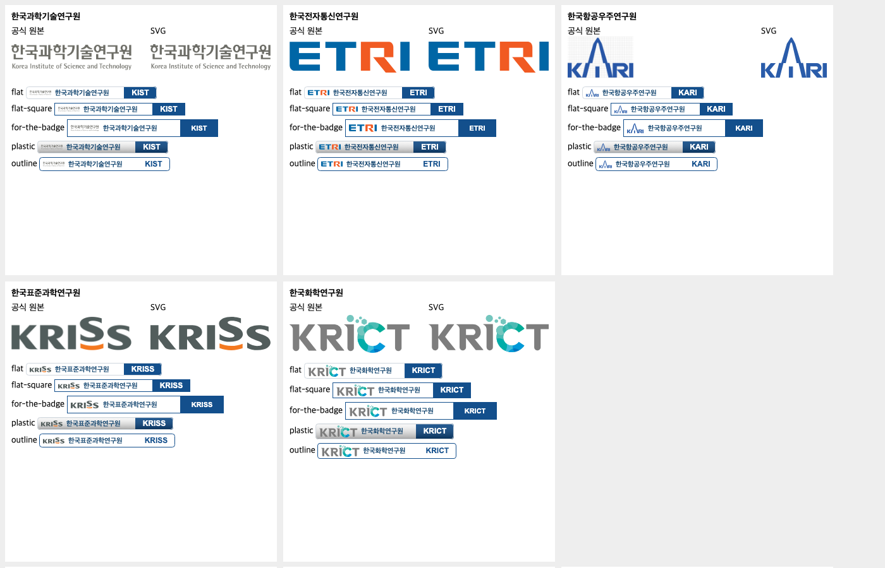

# 연구기관 CI 첫 구현 묶음

공식 ZIP 5건은 기존 기록 SHA-256과 일치하며 ZIP CRC 검사 정상. ZIP 해시와 선택 AI 멤버 해시는 [extraction.json](extraction.json) 및 [출처표](../logo-sources.json)에 별도로 기록했다. 원본은 추적표의 기관 공식 다운로드에서 받을 수 있다.

## 도형·색·완전성 대조

왼쪽은 공식 AI 렌더, 오른쪽은 SVG 렌더다. KARI의 회색 설계 격자는 심벌 구성요소가 아니므로 제외했다. ETRI·KRISS·KRICT는 완전한 공식 워드마크, KARI는 완전한 공식 심벌이다. KIST 다운로드는 한영 로고타입만 제공하므로 이를 전체 추출했으며 별도 심벌을 임의 제작하지 않았다. 이 검증은 다운로드된 공식 제공 아트워크 범위이며 다른 변형 전부에 대한 검증이나 법적 이용 허락이 아니다.

## 실제 배지

원본 경로·곡선 좌표는 유지했다. 인쇄 원본 렌더와 웹 보정 SVG는 **도형 대조**이며 픽셀·색 동일성을 주장하지 않는다. ETRI/KRICT는 공식 이미지의 명시 RGB 숫자, KARI는 공식 웹 HEX로 채움색을 보정했다. KIST는 공식 페이지 DARK GRAY RGB(109,110,103)를 적용했고, KRISS는 원본 렌더러 색을 유지하며 공식 웹 RGB 인증이 아니다.

## 웹 색상 게이트 재검토 (2026-11-19)

[색상별 치환·팔레트·SVG/근거 해시](web-colours.json). 웹 근거 원문과 이미지는 web-colour-evidence/에 저장했다.

- ETRI: https://www.etri.re.kr/korcon/sub7/sub7_11.etri 및 https://www.etri.re.kr/images/kor/sub5/ci_color02.jpg 의 G102 B165(생략 R=0), R241 G90 B34에 따라 #0066a5 / #f15a22. Blue #0066a6을 정정했다.
- KRICT: https://www.krict.re.kr/kor/sub01_05_01.do 및 https://www.krict.re.kr/images/kor/sub01/sub010501_img04.jpg 의 화면용 RGB 숫자를 읽었다. 채널 미기재는 0이며 HTML O/0 문자열을 임의 보정한 것이 아니다. 9색 순서: (116,198,190), (76,187,180), (0,172,151), (46,182,170), (66,189,216), (0,173,169), (0,153,217), (125,125,125), (0,117,194). 4색 수정, 나머지 5색 일치.
- KARI: https://www.kari.re.kr/kor/contents/92 의 Royal Blue HEX #2a5caa 선택. 같은 페이지 RGB(60,45,160)=#3c2da0과 **내부 불일치**다. 웹 매체를 위한 명시 HEX를 RGB 또는 CMYK 렌더 변환값보다 우선했다. 모순 자체를 해결했다고 주장하지 않는다. 웹의 명시 HEX를 사용한 선택과 남은 불확실성을 그대로 기록한다.
- KRISS: https://www.kriss.re.kr/menu.es?mid=a10101070000 의 전용색상은 Gray PANTONE 425C / Orange PANTONE151C만 명시. 숫자 RGB/HEX 명시를 확인하지 못했다. CSS/렌더러 값은 공식 RGB 인증으로 사용하지 않았다.
- KIST: 앞선 HTTP400 접근 실패 이후 브라우저로 공식 CI 안내를 확인했다. DARK GRAY의 명시 RGB R109 G110 B103에 따라 #6d6e67을 적용했다. 근거는 web-colour-evidence/kist-browser-text.txt 및 링크 목록에 남겼다.

기존 공식 PNG는 인쇄 원본 렌더 보존, SVG PNG와 비교 이미지는 현재 색으로 갱신했다. 해시 동일성은 출처 바이트 동일성일 뿐 색 인증이 아니다. 전체 45곳의 최신 공식 가이드 대조는 미완료이며, 5곳도 색상 확인 한계를 남겨 complete=false를 유지한다. 기술적 구현과 전수 재감사 완료는 별개다. 법적 이용 허락 미확인은 유지한다.

## KRICT 최소 사용 폭 수정 (2026-11-19)

공식 근거: https://www.krict.re.kr/images/kor/sub01/sub010501_img01.jpg . Hermes 시각 확인: 최소 15mm는 워드마크 **폭** 기준. CSS 96dpi에서 56.692914px이며 목표 painted 폭은 57px 이상이다. 기존 flat 약33.319px는 미달했다. 원본 비율/21개 경로/색은 그대로 두고 기존 data-min-icon-size=19를 사용한다(57을 양축에 강제하지 않음). 실제 높이19px, 폭 약60.29px, 배지높이25px 이상으로 레이아웃을 확장한다. viewBox만을 검증하지 않고 실제 경로 끝점·직렬화 transform 및 raster alpha bounds를 대조한다. 전체 40 스타일/테마×2언어에서 잘림과 텍스트 겹침을 검사한다.

이는 SVG 고유 크기의 화면 CSS96dpi 환산이며 사용자 축소/CSS resize/인쇄 시 물리적15mm를 보전하지 않는다. 인쇄·축소 사용자는 최종 출력 워드마크 폭15mm 이상을 별도 확보해야 한다. 색상 확인의 한계는 남아 있으며 KARI 내부모순/KIST 미확인/KRISS Pantone 한계는 위 기록을 유지한다. 최소크기 검증: krict-minimum-width.json.

실측 결과: 80/80 alpha painted 폭61px(보수적 실제 경로 끝점 폭58.63px 이상), 잘림0·텍스트겹침0. 32 tests/22,840 generate-check/catalog 통과. 다른 기관 배지 변경0. 기존 head8402fc6의 GH verify 2 SUCCESS 및 영수증 b377af2fdbb4403a90c33c5c6a54347c를 실제 조회해 확인했다(수신은 검토 승인이 아님).

## 후속 검수 (2026-11-19)

Claw가 도형·원본/멤버/SVG 해시·실제 내장 및 80종 최소 폭을 다시 검사했다. 새 5곳 모두 SVG desc에 출처·재배포 허락 미확인·제약 안내를 넣어 모든 생성 배지에도 보존한다. KRICT 크기 수정 후 추출 근거의 SVG 해시를 현행 파일로 동기화했다. KIST는 명시 웹RGB, KRISS는 원본 렌더 색, KARI는 명시 웹 HEX를 사용하며, 이를 RGB 완전 인증 또는 권리 허락으로 표시하지 않는다.
