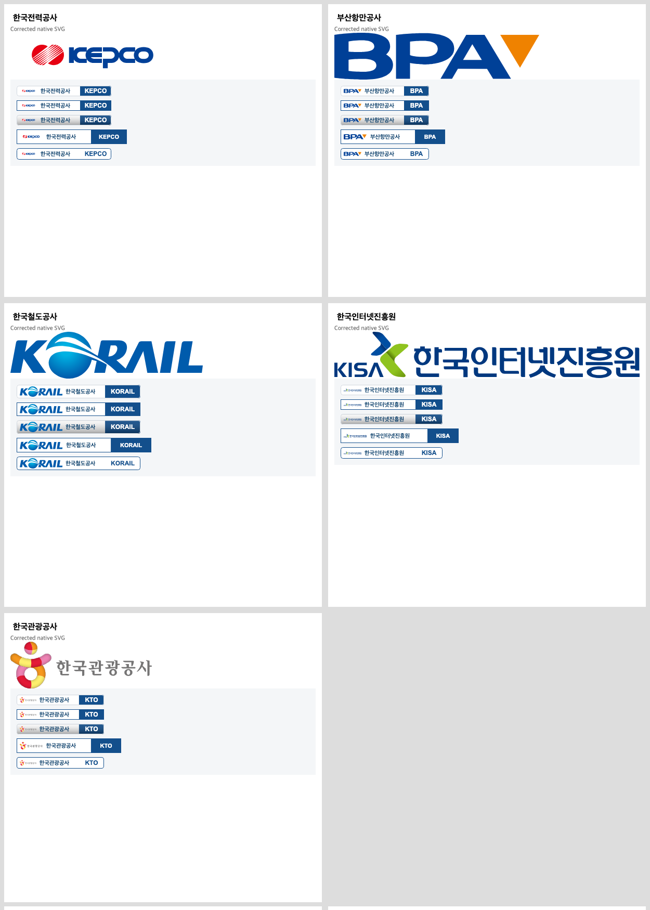
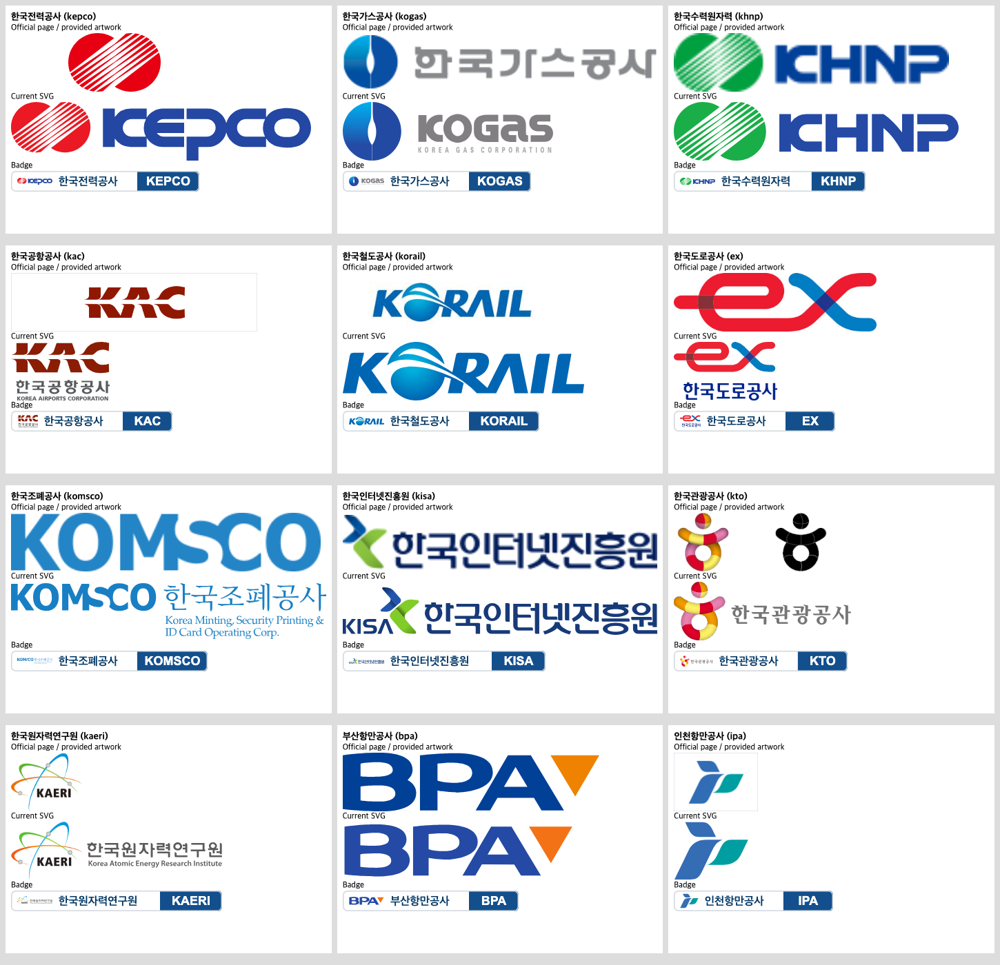
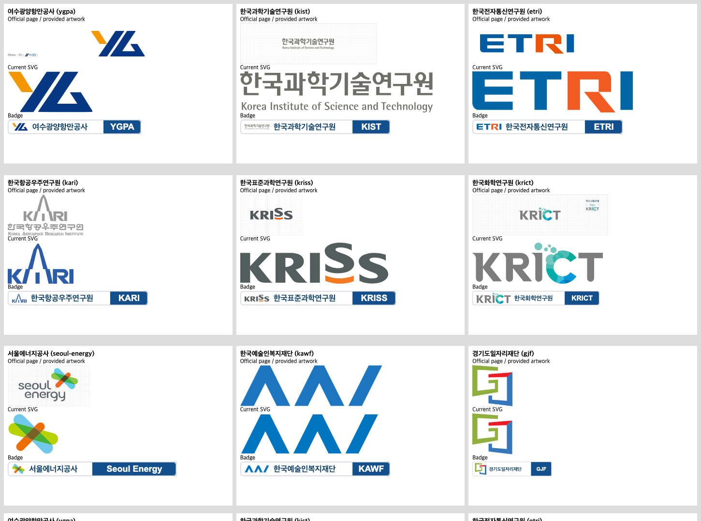

# 기존 CI 정확성 재감사 — 진행 중

현재 제공 중인 공공기관 21곳을 대상으로 한 **1차 공식 자료·도형 대조**다. 색상·최소규격까지 21곳 전체를 정상 판정한 결과가 아니다. 미구현 신규 CI 병합은 재감사가 끝날 때까지 보류한다.

## 이번에 근거가 확정된 정정

- KEPCO: 공식 CI 페이지의 영문 시그니처 SVG 원고로 교체. 색을 추정해 그리지 않고 공식 원고의 `#E60012` / `#004098`를 보존했다. [제공 웹 원고](kepco-signature.svg).
- BPA: 공식 CI 페이지의 심벌 SVG 원고로 교체. 기존 인쇄 렌더 색과 달랐던 `#004097` / `#EF8200`를 공식 웹 파일 그대로 반영했다. [제공 웹 원고](bpa-official-0.svg). 별도로 받은 65쪽 PDF는 **캐릭터 가이드**이므로 심벌 CI 최소규격의 근거로 쓰지 않았다.
- KORAIL: [공식 로고 지침](https://info.korail.com/info/contents.do?key=719)의 최소 폭20mm와 [공식 색상 지침](https://info.korail.com/info/contents.do?key=720)의 WEB #005BAC / #00B2E3 반영. 원본 비례·그라데이션 구조를 보존했다. 80종을 Chrome SVG getBBox/CTM으로 측정해 실제 도형 폭82.31px 이상, 잘림·문구 겹침0건. [측정 근거](korail-measurements.json). CSS96dpi 환산이며 외부 축소·인쇄 최종 물리 크기는 별도 확인해야 한다.
- KISA: [공식 색상표](https://www.kisa.or.kr/604)의 Main Blue / Blue / Dark Blue / Green / Dark Green 5개 RGB를 대응하는 원래 도형·그라데이션 색에 반영했다. 경로·그라데이션 위치와 비율은 변경하지 않았다. [수치 발췌](kisa-colour-evidence.txt).
- KTO: [공식 CI](https://knto.or.kr/eng/AboutCI) 원본 ZIP의 국문 시그니처2와 대조했다. 관광 BI가 아닌 기관 CI이며, 심벌의 분홍·빨강·노랑·주황 4개 RGB를 명시 값으로 정정했다. 그림자 필터·도형과 원고의 회색 로고타입을 유지했다. 회색을 심벌 색상표로 인증한 것은 아니다. [색상표 발췌](kto-colour-evidence.txt), [공식 AI 시트 렌더](kto-official-signature.png).

출처·제약 설명과 별표를 유지한다. 공식 페이지에 제공됐다는 사실을 자유이용 허락으로 바꾸지 않는다. 코레일 공식 페이지의 제4유형 안내와 기존 Commons PD 표기의 차이도 출처 기록에 남겼다.

## 아직 끝나지 않은 항목

서울에너지공사의 명시 RGB와 인쇄 AI 렌더 값의 차이·겹침색 변환, 여수광양항만공사 웹 표의 Orange RGB와 원고·스와치 불일치, KARI 공식 페이지 내부 HEX/RGB 불일치, 가스공사·도로공사 등의 공식 원고·그라데이션 매핑, 일부 기관의 선택 변형별 최소규격 검토가 남아 있다. 여수광양의 5mm x-height/27.5mm 폭 안내는 로고타입 규정이므로 현재 단독 YG 심벌에 그대로 적용하지 않았다. 임의 RGB 추정이나 그림 비교만으로 완료 처리하지 않는다. 항목별 남은 작업은 [21곳 상태·출처·해시](review-21.json)에 기록했다.

KOGAS 다운로드 링크 3개는 200 응답이지만 내용은 빈 HTML이었다. AI/ZIP 원고를 확보한 것으로 세지 않았다. [추가 원본 수신 기록](additional-source-attempts.json).

## 배지 적용·레이아웃 검사

현재 21곳의 80종씩 **1,680개**를 Chrome에서 개별 SVG로 열어 도형 getBBox/CTM을 측정했다. 도형의 배지 경계 이탈·문구 시작점 침범 후보는 0건이다. 이 검사는 실제 SVG 도형 범위를 검사하며 공식 색상·선택 변형의 최소규격 인증이나 외부 CSS/인쇄 크기 검증을 대신하지 않는다. [전체 측정값](all-21-measurements.json).

## 정정 전 공식 자료와 현재 자산 1차 대조

아래는 **정정 전** 비교 화면이다. 기관별 정상 판정표가 아니며 도형·선택 변형·색상 차이를 찾는 조사 자료다. KAWF·GJF는 기존 수집 공식 원고의 심벌 렌더를 사용했다.

## 원본 바이트와 공백 검사

Git에 읽기용으로 보관한 두 공식 SVG는 CRLF를 LF로 정규화했다. 수신 원본 바이트는 각각 `.svg.gz`에 그대로 보관하며, 원본 해시는 gzip 해제 후의 바이트를 기준으로 한다. [원본/정규화 해시](source-normalization.json). 색상표 발췌는 행 끝 공백·빈 줄만 정리했다. 최초 작업 트리 `git diff --check`는 미추적 근거 파일을 포함하지 않았으므로 누적 변경 검증이 아니었다. 재검증은 base부터 PR head까지의 누적 변경으로 수행한다.
